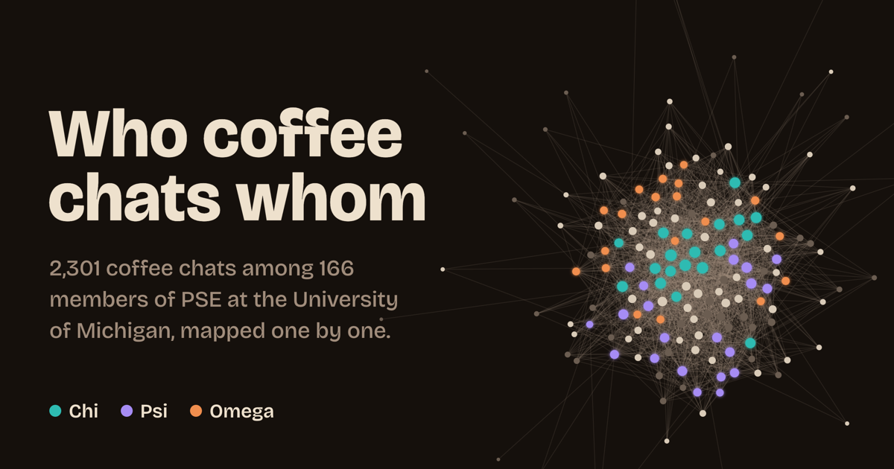

# Who coffee chats whom

**Live at [psechats.coffee](https://www.psechats.coffee)**

An interactive map of every coffee chat between new members and brothers of Pi Sigma Epsilon at the University of Michigan. It covers three pledge classes: Chi (Fall 2025), Psi (Winter 2026) and Omega (Fall 2026).



## Why I made this

At PSE UofM, every new member coffee chats with a long list of brothers during their new member semester. After each chat, the new member sends a thank-you email and copies the Professional Development inbox. That inbox holds a record of who met whom, but nobody had ever looked at it as a whole.

I wanted to know what it would show. Do new members go to the same people every semester? Who meets the most new members? Does anyone get left out? So I parsed the inbox, rebuilt every chat, and presented the findings to the chapter in a slide deck. This site is the interactive version of that deck, so anyone in the chapter can find themselves in the network.

It was a side project, made for fun. It shows patterns in the emails and isn't a grade on anyone.

## What it found

- **Every class skips a generation.** New members chat with the pledge class two above theirs (a year ahead) far more than the class right above. Chi went to Upsilon, Psi to Phi, and Omega to Chi.
- **Everyone is about two handshakes apart.** 2,301 chats link 166 people into a single network, and no two people are more than four steps apart.
- **Gender matters a little, major doesn't matter at all.** Early chats lean toward the same gender, then even out. Sharing a major has no effect on who chats whom.
- **Coaching works fast.** After one round of Professional Development feedback, exclamation points went from 81% of Omega's emails to 0% in a week.
- **Coffee chats rarely mention coffee.** About 2% of the emails mention actual coffee, and Starbucks comes up twice.

## How it works

```
Gmail export (Google Takeout)  →  pipeline/  →  public/data.json  →  static site on Vercel
```

1. **Ingest:** reads the Takeout `.mbox` files and skips any message already stored.
2. **Extract and clean:** keeps one-to-one thank-you emails from new members. Workshops, panels, recruiter emails, apologies and duplicates are removed. People are matched across nicknames by email address.
3. **Export:** writes `public/data.json`, which holds only first names with last initials, pledge class, year and the date of each chat. No email addresses or email contents leave the pipeline, and `export.py` refuses to write the file if one slips through.
4. **Report:** prints the numbers used in the chapter deck and redraws its charts. These outputs stay on my machine.

The site is plain HTML, CSS and JavaScript, with [D3](https://d3js.org) for the force-directed graph. There is no build step and no backend.

## Privacy

- The public site and this repo contain first names and last initials only.
- The raw mail, the member roster, the full-name mapping and the deck's numbers live outside the repo (in `../work/` and `private/`) and are never committed.
- Search engines are blocked with `robots.txt` and an `X-Robots-Tag` header, so the site is reachable only by link.

## Running it locally

```bash
python3 -m http.server -d public
```

Then open http://localhost:8000.

## Adding a new export

```bash
cd pipeline
python3 update.py ~/Downloads/takeout-*.zip
```

- Takes Google Takeout zips or `.mbox` files. Messages already stored are skipped, so re-exporting the whole inbox is fine.
- Add `--roster "new contact sheet.xlsx"` when the member list changes.
- A new pledge class goes in `pipeline/config.json`, and needs a colour in `public/app.js` and `public/style.css`.
- `python3 deck_charts.py` redraws the deck's chart images. It needs matplotlib in `../work/deps` and the deck font in `../work/fonts`.
- After the numbers change, re-render `public/og.png` from `/?og` (the link-preview card).
- Commit `public/data.json` to redeploy.

## Layout

| Path | What it is |
|---|---|
| `public/` | The site Vercel serves: `index.html`, `app.js`, `style.css` and `data.json` |
| `pipeline/` | Python scripts that turn the Gmail export into `data.json` and the deck's numbers |
| `vercel.json` | Security headers and `noindex` |
| `private/` | Gitignored. Full names, manual fixes, deck stats and charts |
